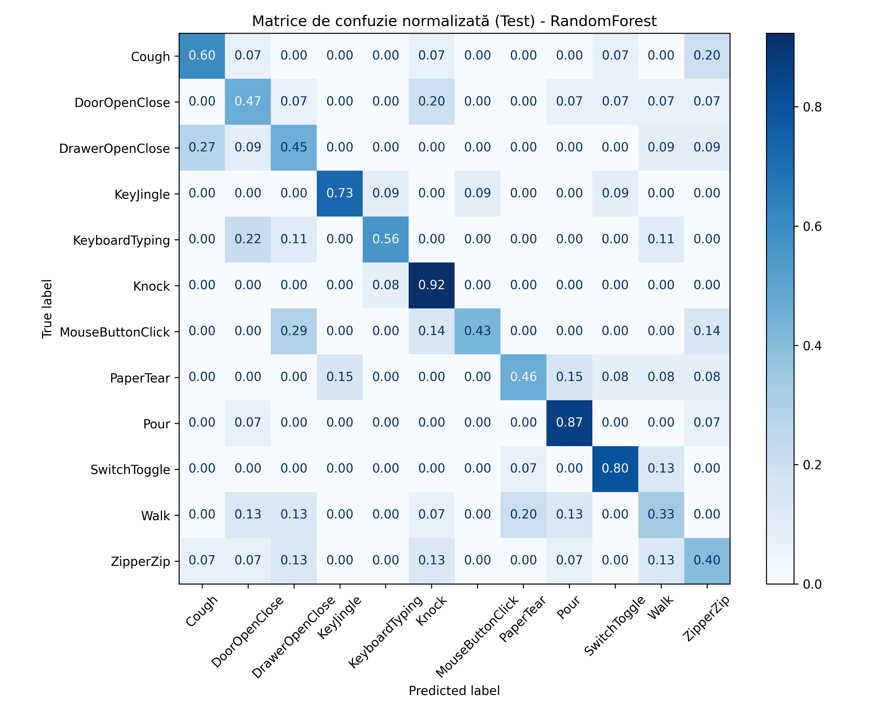

# Recunoașterea Activităților Cotidiene din Semnale Audio (ML)


Proiect de **Învățare Automată** care abordează problema clasificării multinomiale a **12 activități cotidiene** pe baza semnalelor audio (pași, bătaie în ușă, tastare, turnarea unui lichid, fermoar etc.). Proiectul acoperă întregul flux de lucru: extragerea de trăsături acustice, analiza exploratorie a datelor (EDA), antrenarea și optimizarea mai multor modele de clasificare fără scurgeri de date (*data leakage*), precum și evaluarea generalizării pe înregistrări proprii.


## Setul de Date

Setul de date conține **1.537 de clipuri audio** (mono, 16 kHz, durată 2s / 32.000 eșantioane) distribuite în **12 clase** ușor dezechilibrate (`MouseButtonClick` are 75 de clipuri, în timp ce clasele majoritare au 150):

* **Clase:** `Cough`, `DoorOpenClose`, `DrawerOpenClose`, `KeyJingle`, `KeyboardTyping`, `Knock`, `MouseButtonClick`, `PaperTear`, `Pour`, `SwitchToggle`, `Walk`, `ZipperZip`.
* **Împărțire:** Train (`1.229` clipuri – 80%), Validare (`154` clipuri – 10%), Test (`154` clipuri – 10%).
* **Prevenirea scurgerii de date:** Împărțirea este realizată la nivel de `source_id` (toate fragmentele provenite din aceeași înregistrare originală aparțin aceluiași split). Variabilele de context (`pad_s`, `orig_duration_s`, `source_id`) au fost excluse din antrenare.

---

## Extragerea Trăsăturilor (Feature Extraction)

Semnalele audio au fost procesate cu `librosa` folosind ferestre de **512 eșantioane (32 ms)** și un pas de **160 de eșantioane (10 ms)**, rezultând **~50 de trăsături numerice** per clip:

* **Domeniul timp (Nivel & Zgomot):** RMS (dBFS), Factor de creastă (dB), Zgomot de fond (percentila 10), SNR aproximativ (percentila 95 − percentila 10), Ponderea cadrelor active (prag −20 dB față de maxim).
* **Descriptori spectrali (media ponderată cu energia cadrului):** Centroid spectral, Lățime de bandă spectrală, Roll-off 85%, Platitudine spectrală, Rata de trecere prin zero (ZCR).
* **Timbru (MFCC):** 20 de coeficienți cepstrali agregați prin medie și abatere standard (40 de atribute).

---

## Concluzii Cheie din Analiza Exploratorie (EDA)

* **Trăsături cu putere mare de separare:** `active_frame_ratio` separă excelent sunetele continue (`Pour`, mediană ~0.9) de evenimentele impulsive (`SwitchToggle`, `Knock`, `MouseButtonClick`, mediane <0.25). Descriptorii spectrali (`spectral_centroid_mean`, `spectral_rolloff_mean`, `zcr_mean`) izolează clar frecvențele înalte (`KeyJingle`) de cele joase (`Knock`).
* **Trăsături slab informative:** `snr_db` și `background_noise_db` prezintă suprapuneri masive între clase, reflectând mai degrabă condițiile de înregistrare decât sursa sonoră.
* **Multicoliniaritate:** Matricea de corelație a evidențiat redundanțe puternice între descriptorii spectrali (corelație pozitivă aproape de 1) și între zgomotul de fond și SNR (corelație negativă).
* **Non-separabilitate liniară:** Proiecțiile 2D **PCA** și **t-SNE** pe coeficienții MFCC standardizați arată o suprapunere masivă între clasele mecanice și percusive (`Walk`, `DoorOpenClose`, `DrawerOpenClose`), justificând utilizarea modelelor non-liniare.

---

## Metodologie și Rezultate

* **Preprocesare:** Standardizarea (`StandardScaler`) a fost potrivită (*fit*) exclusiv pe setul de antrenare și aplicată ulterior pe validare și test.
* **Căutare hiperparametri:** `RandomizedSearchCV` (15 iterații) cu **5-fold `GroupKFold`** grupat după `source_id` pentru a evita supraînvățarea pe zgomotul de fond al camerelor.

### Comparația Modelelor

| Model | Hiperparametri Aleși | Val Accuracy | Val F1-macro | Test Accuracy | Test F1-macro |
| :--- | :--- | :---: | :---: | :---: | :---: |
| **Logistic Regression** | `C=0.169`, `solver='lbfgs'` | 0.5909 | 0.5812 | 0.5390 | 0.5248 |
| **SVM (RBF)** | `C=1.14`, `kernel='rbf'`, `gamma='scale'` | 0.5779 | 0.5458 | 0.5779 | 0.5722 |
| **Random Forest (Optim)** | `n_estimators=221`, `max_depth=None`, `min_samples_split=8` | 0.5455 | 0.4911 | **0.5909** | **0.5848** |

### Analiza Erorilor (Random Forest – Setul de Test)

* **Clase cel mai bine recunoscute:** `Knock` (92% recall), `Pour` (87%), `SwitchToggle` (80%) și `KeyJingle` (73%), datorită semnăturilor temporale și spectrale distincte identificate la EDA.
* **Clase dificile:** `Walk` (33% recall) este confundată frecvent cu `DoorOpenClose` (13%), `DrawerOpenClose` (13%) și `PaperTear` (20%), din cauza caracterului percusiv de joasă frecvență. Similar, `DrawerOpenClose` (45%) se suprapune acustic cu `DoorOpenClose` și `Cough`.

  


## Rulare Locală / Google Colab

1. Instalează bibliotecile necesare:
   ```bash
   pip install numpy pandas librosa scikit-learn matplotlib seaborn
   ```
2. Deschide `tema1_IA.ipynb` în Jupyter Notebook sau Google Colab și actualizează căile către setul de date audio / fișierul `data/extracted_features.csv`.

---

## Autor

**Ostin Tudor-Mihai** – Grupa 344 C4  
Curs: Învățare Automată
